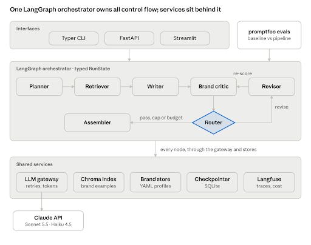

# BrandForge

[](https://github.com/DavidOwenBailey/brandforge/actions/workflows/ci.yml)

BrandForge turns a creative brief into scored, on-brand ad copy. A LangGraph pipeline plans the brief, retrieves approved examples, writes channel variants, critiques them against the brand rubric and revises only what failed. An offline eval compares that pipeline with a single prompt on the same briefs, and records the cost.

## Problem

A single prompt can draft an ad. It does not hold a brand's voice across channels, it does not score what it wrote, and it does not say what the run cost. A team that needs search, social, display and email subject lines then has to review every line by hand, with no record of which prompt, which brand version or which model produced it.

BrandForge is that review, as a bounded workflow. You give it a brief and a brand. It returns the variants, a 1–5 score on the brand's rubric, the lines that still fail, the tokens and the cost. Every run ends in a defined status (`complete`, `partial` or `failed`). The revision loop stops after two passes. A variant that is still below the rubric comes back flagged, with the critic's remaining fixes.

The proof is a comparison, not a demo. Thirty fixed briefs run through the pipeline and through a single-prompt baseline. The same deterministic checks and the same judge score both. The question is whether the pipeline is more on-brand, and what that costs per brief.

The copy is text. The brands are fictional:

| Brand | Voice | Product |
| --- | --- | --- |
| `brightleaf` | Warm, plain-spoken, gently playful | Tea |
| `ledgerly` | Calm, precise, trustworthy | Bookkeeping software |
| `voltride` | Confident, energetic, direct | Commuter e-bikes |

Channels are `search`, `social`, `display` and `email`. An email variant's headline is the subject line.

## Architecture



The Typer CLI, `POST /generate`, the Streamlit page and the promptfoo harness call one compiled graph. The graph is planner, retriever, writer, brand critic, then a router. The router sends failing variants to the reviser and back to the critic, at most twice. Every path ends at the assembler, which packages the variants, scores, flags, cost and trace id.

Agents are functions over a typed run state. The router owns control flow. Every model call goes through one gateway, which validates the schema, retries, enforces the run budget and counts tokens. A thin adapter per provider speaks that provider's SDK. The default tiers are Anthropic. A tier set to `gemini:<model-id>` uses the Gemini adapter. Brand profiles and rubrics are versioned YAML. Approved examples live in a local Chroma index, one collection per brand. Checkpoints are SQLite. Traces go to Langfuse.

The design is [docs/architecture.md](docs/architecture.md). The decisions are in [docs/adr](docs/adr).

## Five-minute quickstart

You need [uv](https://docs.astral.sh/uv/) and an API key. uv installs the pinned Python (3.12). The default model tiers are Anthropic, so a fresh clone needs `ANTHROPIC_API_KEY`. A tier written as `gemini:<model-id>` needs `GEMINI_API_KEY` as well.

```bash
git clone https://github.com/DavidOwenBailey/brandforge.git
cd brandforge
uv sync
cp .env.example .env
```

Open `.env` and set `ANTHROPIC_API_KEY`. Skip the copy when `.env` already exists, so you keep the keys that are there.

```bash
uv run brandforge generate --brand voltride --brief src/brandforge/briefs/voltride_01_commuter_ebike.yaml
```

The command prints the variants (headline, body, call to action), a score table, the run status, the token cost split by node, a Run ID and a Trace ID. Logs are JSON on stderr, one object per line, each carrying that run id. `BRANDFORGE_LOG_FORMAT=console` renders the same fields for a person.

A brief file has `product`, `audience`, `objective` (`awareness`, `consideration` or `conversion`), `channels` and optional `constraints`. Ten samples live in `src/brandforge/briefs/`.

The state is saved after every node in `.brandforge/checkpoints.sqlite`.

```bash
uv run brandforge inspect <run-id>
uv run brandforge inspect <run-id> --step 3
```

The first command lists each node. `--step` prints the full state at one of them.

That first generate runs with no example index. The retriever logs a warning and the writer has no approved ads to lean on. Build the index when you want retrieval. It uses a local embedding model and needs no API key. The first run downloads that model into `~/.cache/chroma/onnx_models/`.

```bash
uv run brandforge index
```

`BRANDFORGE_RETRIEVAL_ENABLED=false` skips the search on purpose. That is how an eval compares the pipeline with and without examples. The index command still builds the index.

`uv run poe check` runs Ruff, mypy strict and pytest. It does not call a model.

## API, demo page and Docker

`uv run brandforge serve` starts the same pipeline on `127.0.0.1:8000`. `POST /generate` takes a JSON `brand` and `brief` (the same fields as a brief file) and returns the run result, including the trace id. A finished run is HTTP 200 when its status is `partial` or `failed`. That status is in the body. Interactive OpenAPI docs are at <http://127.0.0.1:8000/docs>. The route has no authentication. `BRANDFORGE_API_HOST` and `BRANDFORGE_API_PORT` change the address.

`uv run brandforge demo` opens a page at <http://127.0.0.1:8501>. Pick a brand, paste a brief (YAML or JSON) and the page shows the variants, scores and flags from `POST /generate`. Start the API first. The page does not call a model itself. `BRANDFORGE_DEMO_HOST`, `BRANDFORGE_DEMO_PORT` and `BRANDFORGE_API_BASE_URL` change the addresses.

`docker compose up` starts the API and the demo page together, on this machine. The API is at <http://127.0.0.1:8000> and the page is at <http://127.0.0.1:8501>. The same `.env` is required, and one `ANTHROPIC_API_KEY` is enough for the default tiers. OpenAPI docs are at <http://127.0.0.1:8000/docs>.

```bash
docker compose up
docker compose run --rm api brandforge index
docker compose exec api brandforge inspect <run-id>
docker compose down
```

The containers listen on `0.0.0.0` so the demo can call the API. The published ports bind to `127.0.0.1`. Details are in [ADR 0034](docs/adr/0034_docker_compose.md).

## Tracing

Tracing is optional. The default backend is Langfuse Cloud's free tier at `https://cloud.langfuse.com`. Put the project's `LANGFUSE_PUBLIC_KEY` and `LANGFUSE_SECRET_KEY` in `.env` and leave `LANGFUSE_HOST` at `https://cloud.langfuse.com`. Each run is one trace, with a span per node and a generation per model call. The CLI prints the trace id.

With either key empty, or with `BRANDFORGE_TRACING_ENABLED=false`, the run is unchanged and the CLI says tracing is off.

To keep traces on the laptop, start the optional stack in `deploy/langfuse/docker-compose.yml` and point `LANGFUSE_HOST` at it. `docker compose up` does not start that stack. The steps are in [docs/langfuse.md](docs/langfuse.md).

## Evaluation

The suite asks whether the full pipeline writes more on-brand copy than one prompt, and at what cost. The dataset is 3 brands × 10 briefs, one YAML file each under `evals/cases/`. Two systems run every case: a single prompt (the writer model, the brief and the brand profile) and the full graph. promptfoo is the runner. The wiring is in [docs/promptfoo.md](docs/promptfoo.md).

Three checks sit on each row:

| Layer | What it decides |
| --- | --- |
| Deterministic | Valid JSON, the eval-row schema, headline caps, the requested channels, banned words absent, a call to action, and any required phrase. These must pass. They do not call a model. |
| Judge | One model grades each variant on its own, on the judge tier, against that brand's 1–5 anchors for voice, clarity and the call to action. The row score is the mean. |
| Calibration | `uv run brandforge calibrate` compares the judge with 15 hand-scored outputs in `evals/calibration/`. Quadratic weighted kappa below 0.60 means the anchors need tuning. The command calls the model. CI checks the files and the arithmetic with a faked judge. |

A graded brief passes when its judge mean is at least 4.0 and every criterion mean is at least 3. That pass rate is a report. It does not fail CI. The baseline has no critic, so its flagged-variant rate is not scored. Judge tokens stay off the token and cost totals.

### Results

This repository has no committed 30-case summary. The manual run is what produces `evals/results/full.md` and `evals/results/full.json` ([ADR 0031](docs/adr/0031_eval_results_and_smoke.md)). `uv run poe check` does not create those files and does not call a model.

The table below is the comparison that summary publishes, baseline beside pipeline. A dash means that cell has not been measured. The baseline flagged cell is the summarizer's own mark for a system that has no critic.

| Measure | Baseline | Pipeline |
| --- | --- | --- |
| Judge mean (1-5) | — | — |
| Voice | — | — |
| Clarity | — | — |
| Call to action | — | — |
| Judge pass rate | — | — |
| Deterministic pass rate | — | — |
| Flagged-variant rate | not scored | — |
| Mean tokens per brief | — | — |
| Mean cost per brief | — | — |
| Mean latency per brief | — | — |

The per-brief breakdown, the model names and the prompt versions are written into `evals/results/full.md` by the process that ran the eval. Summarize on that machine. The export itself does not record which model served each tier.

To produce the table, from the repository root, with Node and a funded key:

```bash
npx promptfoo@latest eval \
  --env-file .env \
  --config evals/promptfooconfig.yaml \
  --output evals/output/full.json \
  --no-share

uv run brandforge eval-summary evals/output/full.json --output evals/results/full
```

`eval-summary` does not call a model. If promptfoo imports the wrong interpreter, set `PROMPTFOO_PYTHON` to the path from `uv run python -c "import sys; print(sys.executable)"`.

CI has a separate five-case smoke config, `evals/promptfooconfig.smoke.yaml`. The GitHub Actions job is paused (`if: false`) until the repository has an `ANTHROPIC_API_KEY` secret. When it is on, it uses the default Anthropic tiers, does not build the example index, and does not compare its scores with `evals/results/full.md`. A provider error, a failed hard check, or a judge that cannot grade fails the job. A low judge score does not.

## Limitations

- The pipeline writes text. It does not generate images or video, and it does not fine-tune a model.
- The three brands, the briefs and the approved examples are fictional. There is no customer data and no tenant isolation.
- `POST /generate` and the demo page have no authentication. They are for this machine. Docker publishes them on `127.0.0.1`.
- The revision loop stops after two passes, or earlier when the token budget or the wall-clock budget is spent. Flagged variants are returned with the run.
- A node that still fails after retries is recorded, and the assembler returns whatever the run has. The status is `partial` or `failed`.
- Retrieval uses Chroma's local MiniLM embeddings. A missing index, or retrieval switched off, does not stop the run. The writer then has no examples.
- The judge is a model. Agreement with a person is a manual `brandforge calibrate` run, and the 30-case numbers are not committed yet.
- The CI smoke eval is paused until `ANTHROPIC_API_KEY` is a repository secret. `uv run poe check` stays offline.
- There is no OpenAI adapter. Checkpoints and the example index are local files (SQLite and Chroma).
- The default wall-clock budget is 90 seconds. The architecture's hope of about 60 seconds for one brief is still a target to measure, not a guarantee.

## Next steps

- Run the 30-case eval with the commands above and commit `evals/results/full.md` and `evals/results/full.json`. Replace the dashes in the results table with that summary.
- Run `uv run brandforge calibrate`. When kappa is below 0.60, tune the rubric anchors and run it again.
- From that run, confirm the pass thresholds (`BRANDFORGE_THRESHOLDS__MIN_OVERALL`, `BRANDFORGE_THRESHOLDS__MIN_PER_CRITERION`) and compare retrieval on and off.
- Turn the smoke job on by removing `if: false` in `.github/workflows/ci.yml` once the Anthropic secret is set. Fork pull requests stay skipped, because they do not receive the secret.
- A clean clone should follow this README and succeed (BF-44). The v1.0.0 tag and a short demo video are BF-45. The judge, the contracts and the local stores are ADRs [0005](docs/adr/0005_judge_model.md), [0006](docs/adr/0006_pydantic_contracts.md) and [0007](docs/adr/0007_local_first.md).
- The production path in the architecture is still open: a Postgres checkpointer and pgvector, authentication and per-brand isolation, a review queue for flagged variants, an eval gate on prompt changes, and online measurement of the copy that ships.

## Layout

```text
src/brandforge/
├── agents/        # planner, retriever, writer, critic, reviser, assembler
├── llm/           # gateway and per-provider adapters
├── retrieval/     # approved examples and the Chroma index
├── brands/        # brand profiles and rubrics (YAML)
├── prompts/       # versioned prompt files
├── evals/         # case loader, judge, calibration, result summary
└── interfaces/    # CLI, HTTP API and demo page
evals/             # the 30 cases, promptfoo config, calibration files
docs/              # architecture, ADRs, promptfoo and Langfuse guides
```

## Licence

[MIT](LICENSE)
